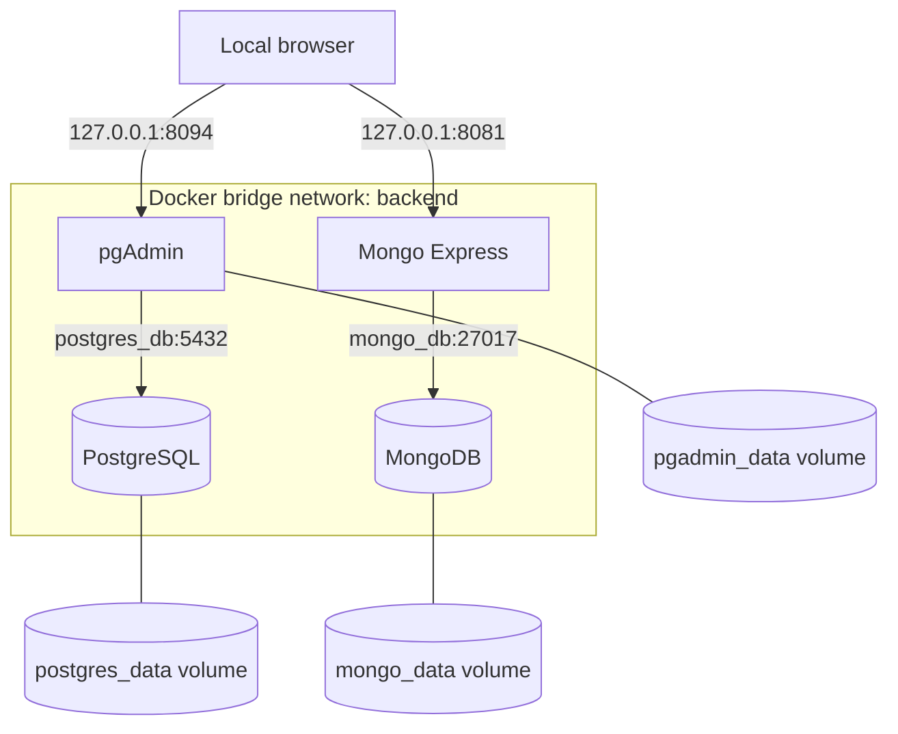
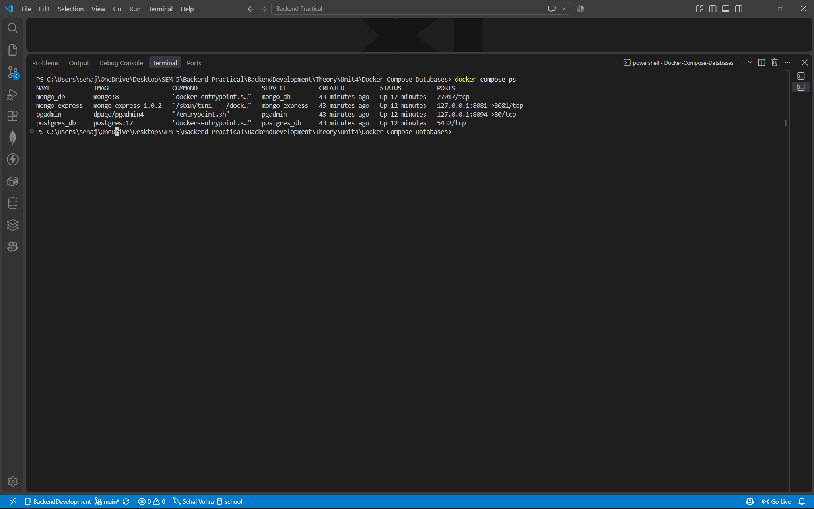
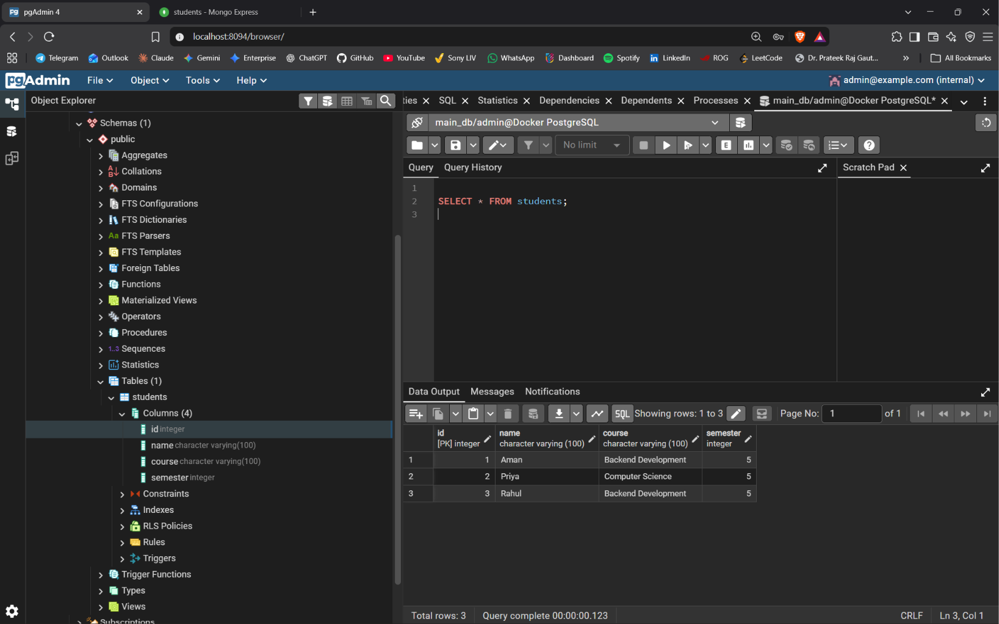
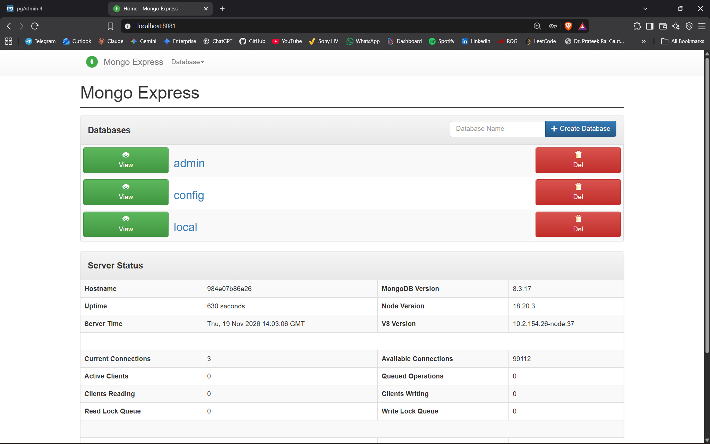
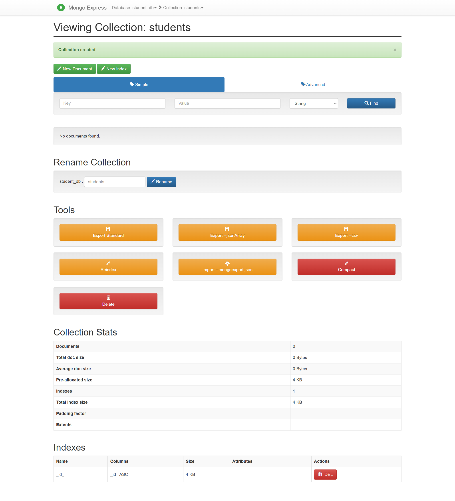
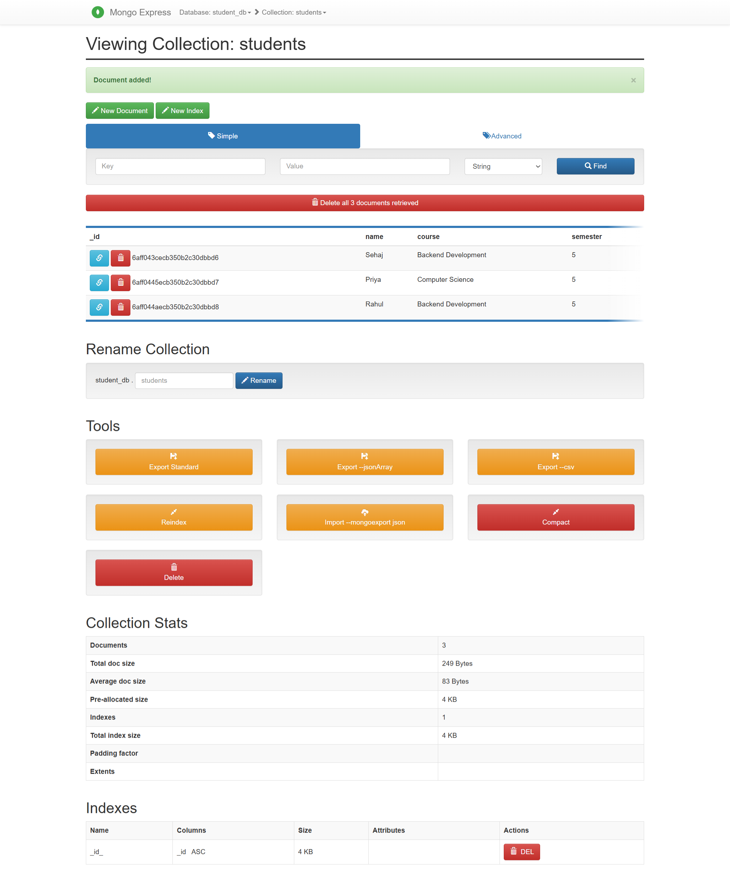
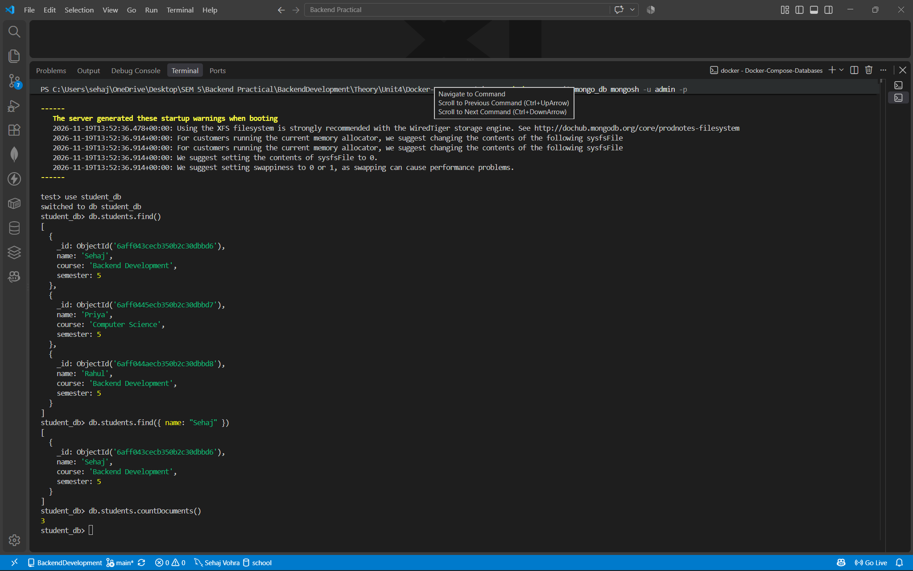
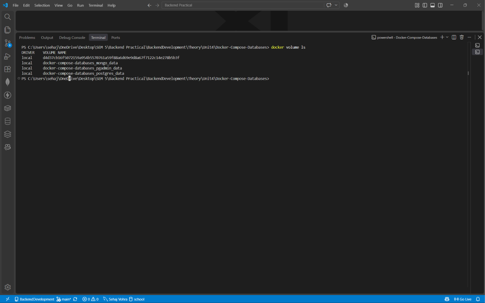
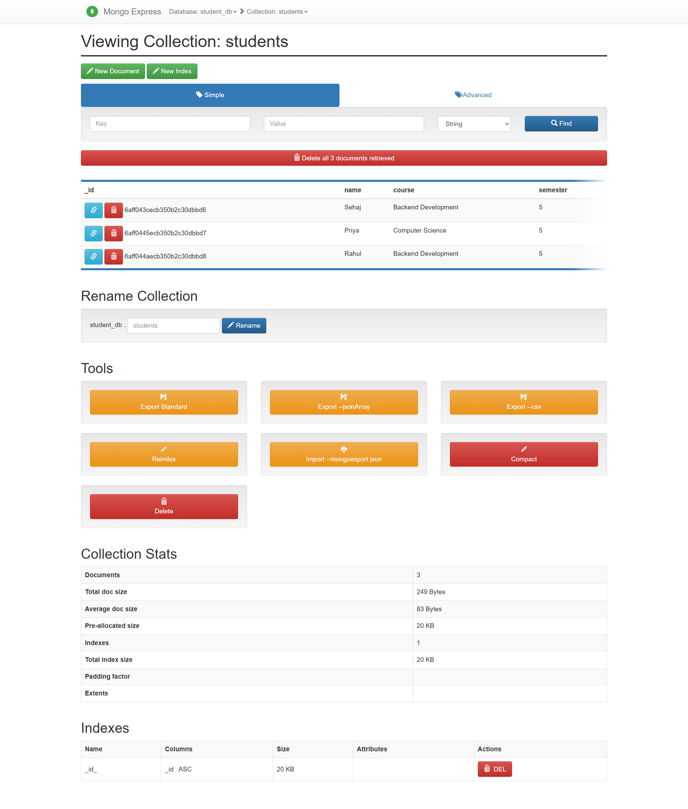

# Running PostgreSQL and MongoDB with Docker Compose

**Course:** Backend Development  
**Unit:** 4 — Docker and Containerization  
**Practical:** Database deployment and administration using Docker Compose  
**Student:** Sehaj  
**Date:** 19 November 2026  
**Project path:** `BackendDevelopment/Theory/Unit4/Docker-Compose-Databases/`

---

## 1. Aim

Deploy PostgreSQL and MongoDB as Docker containers using Docker Compose, manage them through pgAdmin and Mongo Express, perform basic database operations, and verify persistent storage across container restarts.

## 2. Learning objectives

- Define and run a multi-service Docker Compose application.
- Use a private Docker bridge network for database connectivity.
- Access PostgreSQL through pgAdmin and MongoDB through Mongo Express.
- Create sample data and query it using SQL and MongoDB shell commands.
- Verify container status, logs, named volumes, and persistence after restart.

## 3. Tools and technologies

| Component | Image / tool | Role |
|---|---|---|
| Docker Desktop | Docker Engine and Compose | Container orchestration |
| PostgreSQL | `postgres:17` | Relational database |
| pgAdmin | `dpage/pgadmin4` | PostgreSQL web administration |
| MongoDB | `mongo:8` | Document database |
| Mongo Express | `mongo-express:1.0.2` | MongoDB web administration |
| VS Code / PowerShell | Local development environment | Configuration and commands |

The observed PostgreSQL log identifies version **17.12**, and the Mongo Express dashboard reports MongoDB **8.3.17**. Image tags are the values configured in `compose.yaml`.

## 4. Architecture



Only the administration interfaces are published to the host, and both bind to `127.0.0.1`. The database ports are accessible to containers on the Compose network but are **not** published to the host.

## 5. Project structure

```text
Docker-Compose-Databases/
├── compose.yaml
├── .env                 # Local credentials; do not commit
├── .gitignore
├── Report.md
└── screenshots/
    ├── mongo-express-dashboard..png
    ├── mongodb-collection.png
    ├── mongodb-students-inserted.png
    ├── mongodb-query-results.png
    ├── docker-containers-status.png
    ├── docker-persistent-volumes.png
    ├── postgres-data-persistence.png
    ├── mongodb-data-persistence.png
    └── currentScreenshot1795097052132.png
```

The source archive also includes `screenshots/desktop.ini`, a Windows metadata file not needed for the report. The double period in `mongo-express-dashboard..png` is preserved in image references to match the supplied file.

## 6. Docker Compose configuration

The supplied `compose.yaml` defines four services, one bridge network, and three named volumes.

| Service | Container name | Port / connectivity | Storage |
|---|---|---|---|
| PostgreSQL | `postgres_db` | Internal `5432` | `postgres_data:/var/lib/postgresql/data` |
| pgAdmin | `pgadmin` | `127.0.0.1:8094:80` | `pgadmin_data:/var/lib/pgadmin` |
| MongoDB | `mongo_db` | Internal `27017` | `mongo_data:/data/db` |
| Mongo Express | `mongo_express` | `127.0.0.1:8081:8081` | None configured |

`depends_on` establishes container startup ordering for the admin interfaces but does not itself guarantee database readiness. Each service uses `restart: unless-stopped` and joins the `backend` network. Environment variables supply database users, passwords, and admin-interface credentials.

### Environment file

Create a local `.env` file with the variable names below and **replace the placeholders** with secure credentials. Do not publish actual passwords.

```dotenv
POSTGRES_USER=admin
POSTGRES_PASSWORD=<choose-a-strong-password>
POSTGRES_DB=main_db
PGADMIN_DEFAULT_EMAIL=admin@example.com
PGADMIN_DEFAULT_PASSWORD=<choose-a-strong-password>
MONGO_ROOT_USERNAME=admin
MONGO_ROOT_PASSWORD=<choose-a-strong-password>
MONGO_EXPRESS_USERNAME=admin
MONGO_EXPRESS_PASSWORD=<choose-a-strong-password>
```

The project's `.gitignore` contains `.env` to prevent accidental Git tracking. This only applies to files not already tracked by Git; verify with `git status` before committing.

## 7. Procedure and execution

### 7.1 Validate and start the stack

From the project directory, execute:

```powershell
docker compose config --quiet
docker compose up -d
docker compose ps
```

The configuration validation completed without errors. Docker downloaded the required images, created the `backend` network and three named volumes, and started all four containers. The recorded `docker compose ps` output shows all services in the `Up` state.



### 7.2 Connect to PostgreSQL through pgAdmin

Open `http://localhost:8094` and sign in using the configured pgAdmin credentials. Register a server with:

| Field | Value |
|---|---|
| Name | Docker PostgreSQL |
| Host | `postgres_db` |
| Port | `5432` |
| Maintenance database | `main_db` |
| Username | `admin` |
| Password | Value of `POSTGRES_PASSWORD` |

The host is `postgres_db`, not `localhost`, because pgAdmin connects over the Docker network.

### 7.3 Create and query PostgreSQL records

In pgAdmin's Query Tool for `main_db`, create a student table:

```sql
CREATE TABLE students (
    id SERIAL PRIMARY KEY,
    name VARCHAR(100) NOT NULL,
    course VARCHAR(100),
    semester INT
);
```

Insert sample rows (the name Sehaj is used in the final demonstrated records):

```sql
INSERT INTO students (name, course, semester)
VALUES
    ('Sehaj', 'Backend Development', 5),
    ('Priya', 'Computer Science', 5),
    ('Rahul', 'Backend Development', 5);
```

Retrieve records:

```sql
SELECT * FROM students;
```

The supplied pgAdmin persistence screenshot shows a successful `SELECT * FROM students` with **three returned rows**. The displayed table verifies that PostgreSQL remained queryable after the restart. The SQL above documents the intended sample data; it should not be rerun against an already-populated table without checking for duplicates.



### 7.4 Access MongoDB through Mongo Express

Open `http://localhost:8081` and sign in using the Mongo Express basic-auth credentials. The dashboard displayed the system databases `admin`, `config`, and `local`, along with server status information.



### 7.5 Create MongoDB database and collection

Create database `student_db`, then collection `students`. The collection page initially showed **0 documents** and the default `_id_` index.



### 7.6 Insert MongoDB documents

Using **New Document** in Mongo Express, insert three JSON documents:

```json
{"name":"Sehaj","course":"Backend Development","semester":5}
```

```json
{"name":"Priya","course":"Computer Science","semester":5}
```

```json
{"name":"Rahul","course":"Backend Development","semester":5}
```

MongoDB automatically assigns each document an `_id`. The collection screenshot shows three stored documents and a document count of **3**.



### 7.7 Query MongoDB using mongosh

Open the MongoDB shell inside its container:

```powershell
docker exec -it mongo_db mongosh -u admin -p
```

Enter the root password when prompted. Then run:

```javascript
use student_db
db.students.find()
db.students.find({ name: "Sehaj" })
db.students.countDocuments()
```

The expected count is **3**. The provided terminal screenshot records the MongoDB query workflow and returned documents.



## 8. Container logs and health checks

Commands used:

```powershell
docker compose ps
docker compose logs --tail=20 postgres_db
docker compose logs --tail=20 mongo_db
```

Observed results:

- All four containers reported `Up`.
- PostgreSQL logs included `database system is ready to accept connections`.
- MongoDB logs contained informational WiredTiger checkpoint messages; no fatal error is visible in the supplied excerpt.

An `Up` status is a container-state check, not a full application health check. Database queries and successful web-interface access provide additional functional evidence.

## 9. Persistent volumes and restart test

List volumes:

```powershell
docker volume ls
```

The recorded output includes:

```text
docker-compose-databases_mongo_data
docker-compose-databases_pgadmin_data
docker-compose-databases_postgres_data
```



Restart services without removing volumes:

```powershell
docker compose restart
docker compose ps
```

After the restart, all four services again reported `Up`. Reopening pgAdmin and Mongo Express showed the student data still present, demonstrating persistence across a **container restart**.



**Scope of verification:** This confirms restart persistence. It does not by itself prove recovery after deleting and recreating volumes, and no destructive test was performed.

## 10. Results

| Test | Evidence | Outcome |
|---|---|---|
| Compose configuration validation | `docker compose config --quiet` | Passed |
| Four containers start | `docker compose up -d`, `docker compose ps` | Passed |
| PostgreSQL connectivity | pgAdmin query result | Passed |
| PostgreSQL table query | `SELECT * FROM students;` | Three rows visible |
| Mongo Express connectivity | Dashboard screenshot | Passed |
| MongoDB collection creation | `student_db.students` screenshot | Passed |
| MongoDB insert and read | Collection and shell screenshots | Three documents visible |
| Persistent volumes exist | `docker volume ls` | Three named volumes present |
| Containers restart | `docker compose restart`, `docker compose ps` | Passed |
| Data remains after restart | pgAdmin and Mongo Express screenshots | Passed |

## 11. Key observations

1. Docker Compose manages multiple related services using one YAML configuration.
2. Docker service names (`postgres_db`, `mongo_db`) work as hostnames on the shared bridge network.
3. Binding admin interfaces to `127.0.0.1` restricts direct host-port access to the local machine.
4. Named volumes retain database state across ordinary container restarts.
5. PostgreSQL uses tables and SQL, while MongoDB stores JSON-like documents in collections.
6. Web-based admin interfaces simplify local inspection, but production deployments require stronger authentication, network controls, and careful image/version management.

## 12. Precautions

- Never commit `.env`, credentials, or database backups containing sensitive data.
- Avoid `docker compose down -v` unless intentionally deleting persistent data.
- Do not expose database ports or admin dashboards publicly without appropriate security controls.
- Consider pinning the pgAdmin image version for repeatable deployments; the supplied configuration uses `dpage/pgadmin4` without an explicit version tag.
- Use unique, strong passwords rather than demonstration defaults.

## 13. Conclusion

The practical successfully deployed PostgreSQL, pgAdmin, MongoDB, and Mongo Express using Docker Compose. Both databases were accessed through their management interfaces, sample student data was created and queried, and Docker logs and named volumes were inspected. Restarting the containers preserved the recorded data, demonstrating the value of persistent Docker volumes in a local backend-development environment.

## 14. References

- [Docker Compose documentation](https://docs.docker.com/compose/)
- [Docker volumes documentation](https://docs.docker.com/engine/storage/volumes/)
- [PostgreSQL documentation](https://www.postgresql.org/docs/)
- [pgAdmin documentation](https://www.pgadmin.org/docs/)
- [MongoDB documentation](https://www.mongodb.com/docs/)
- [Mongo Express repository](https://github.com/mongo-express/mongo-express)
- Original instructor-provided GitHub Gist: `prateekrajgautam/0cbd7284d2a517135744563b19a150de`

---

*This report is based on the supplied Compose project, screenshots, and terminal output. Password values are intentionally omitted.*
