# Lecture 37–39 Practical Report

## Deployment Environments, Containerization, and Docker

| Student Information | Details |
|---|---|
| **Name** | Sehaj Vohra |
| **SAP ID** | 590011624 |
| **Course** | Backend Development |
| **Program** | B.Tech Computer Science and Engineering |
| **Semester** | 5 |

---

## 1. Objective

To understand deployment environments and containerization, install and verify Docker, develop equivalent Student API applications using FastAPI and Express, create separate Docker images for both applications, run the containers with port mapping, and verify the required HTTP endpoints.

## 2. Software and Tools Used

| Software / Tool | Version or Configuration | Purpose |
|---|---|---|
| Operating System | Windows | Development environment |
| Docker Desktop | 29.9.2 | Docker desktop environment |
| Docker Engine | Linux containers using WSL 2 backend | Build and run containers |
| Docker CLI | 29.9.2 | Image and container commands |
| Python base image | `python:3.12-slim` | FastAPI container |
| FastAPI | 0.115.6 | Python web framework |
| Uvicorn | 0.34.0 | ASGI server |
| Node.js base image | `node:22-alpine` | Express container |
| Express | `^4.21.2` | Node.js web framework |
| HTTP client / browser | Used for endpoint requests | API verification |
| Visual Studio Code | Development editor | Source code editing |

## 3. Problem Statement

Create the same Student API using FastAPI and Express. Build an independent Docker image for each implementation, run both containers, and verify the following endpoints:

| HTTP Method | Endpoint | Expected Function |
|---|---|---|
| `GET` | `/` | Return the application name, framework, and running status |
| `GET` | `/health` | Return the application health status |
| `GET` | `/students` | Return the list of student records |

Both applications must be accessible at the same time through separate host ports.

## 4. Task Summary

| Task | Practical Work | Outcome |
|---|---|---|
| **Task 1** | Install and verify Docker | Docker Desktop, Docker CLI, Docker Engine, and the `hello-world` image were verified. |
| **Task 2** | Create and containerize the FastAPI Student API | FastAPI application and Docker image `student-api-fastapi:1.0` were created and tested. |
| **Task 3** | Create and containerize the Express Student API | Express application and Docker image `student-api-express:1.0` were created and tested. |
| **Task 4** | Run and test both containers together | Both APIs ran simultaneously on separate host ports and returned the expected responses. |
| **Task 5** | Inspect images and logs, then clean up containers | Images and logs were inspected; both test containers were stopped and removed. |

---

## 5. Task 1: Install and Verify Docker

### Task Given

Install Docker in the development environment and verify that the Docker command line tool and Docker Engine can run containers.

### Implementation

Docker Desktop was installed on Windows using the WSL 2 backend. During setup, the Windows Subsystem for Linux and Virtual Machine Platform features were enabled. The system was restarted and WSL 2 was configured.

Docker was verified using the following commands:

```powershell
docker --version
wsl --status
docker run hello-world
docker images
docker ps -a
```

The `hello-world` image was downloaded and executed successfully. Docker image and container listing commands were also used to inspect the result. The Docker Engine was subsequently confirmed to be available for building and running the Student API containers.

### Code / Command Location

This task involved Docker Desktop configuration and Docker CLI commands. It does not introduce an application source file.

### Screenshots

**Docker Hello World verification**

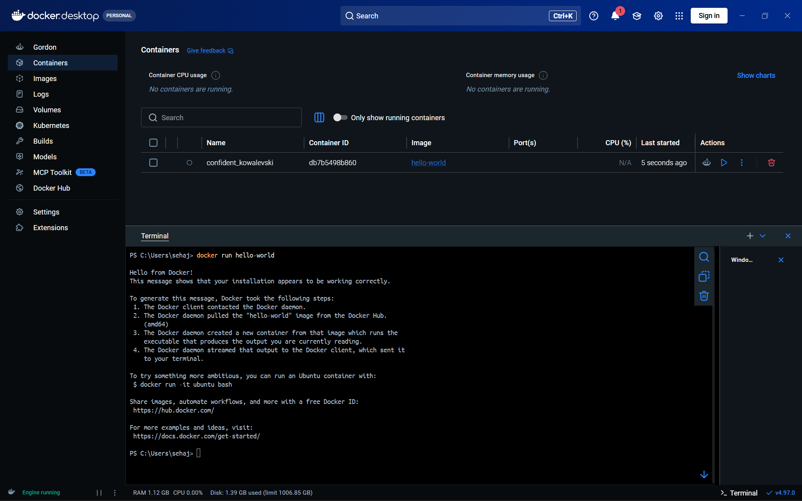

**Docker image listing**

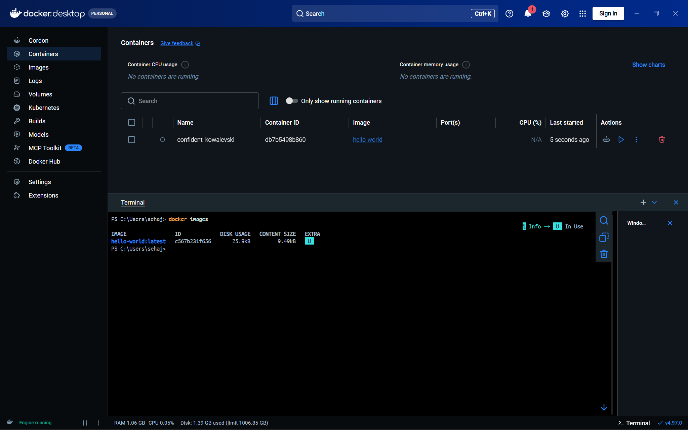

**Docker container listing**

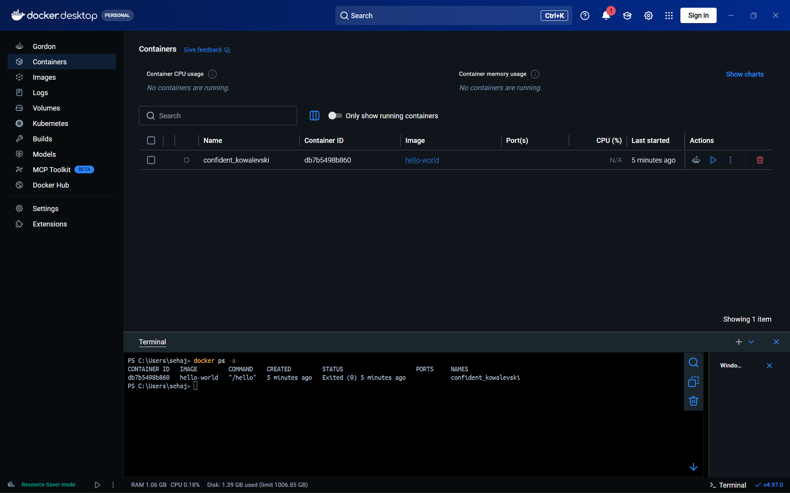

**Docker running containers verification**

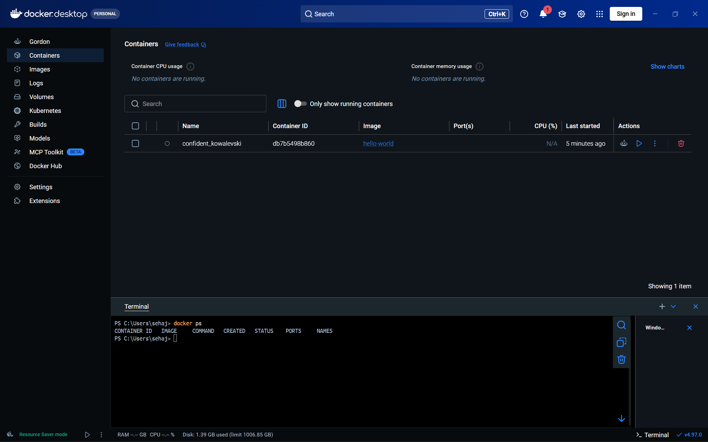

### Result

Docker Desktop and the Docker Engine were verified successfully. The `hello-world` image ran and displayed its success message, confirming that Docker could download and execute a container.

---

## 6. Task 2: Create and Containerize the FastAPI Student API

### Task Given

Create a Student API using FastAPI with the `/`, `/health`, and `/students` GET endpoints. Define the Python dependencies, create a Dockerfile and `.dockerignore`, build a Docker image, and run the application in a container.

### Implementation

The FastAPI application was implemented in `main.py`. It defines the application title and a student list containing two records:

| Student ID | Name | Course |
|---:|---|---|
| 1 | Aarav | Backend Development |
| 2 | Diya | Backend Development |

The application provides three GET endpoints:

| Endpoint | Implementation |
|---|---|
| `/` | Returns the application name, framework name, and running status. |
| `/health` | Returns `{"status": "healthy"}`. |
| `/students` | Returns the student records. |

The dependencies were specified in `requirements.txt`:

```text
fastapi==0.115.6
uvicorn[standard]==0.34.0
```

The Dockerfile uses `python:3.12-slim` as its base image. It sets `/app` as the working directory, installs the declared dependencies, copies `main.py`, exposes port `8000`, and starts Uvicorn on `0.0.0.0:8000`.

The `.dockerignore` file excludes Python cache files, bytecode, the virtual environment, and the Git directory from the Docker build context.

The image was built with the tag `student-api-fastapi:1.0`. The container was run with host port `8000` mapped to container port `8000`.

### Code Location

| File | Purpose | GitHub Source |
|---|---|---|
| `main.py` | FastAPI application and API routes | [View main.py](https://github.com/sehajvohra/BackendDevelopment/blob/main/Theory/Unit4/Lecture37-39/docker-student-api/fastapi-app/main.py) |
| `requirements.txt` | Python dependencies | [View requirements.txt](https://github.com/sehajvohra/BackendDevelopment/blob/main/Theory/Unit4/Lecture37-39/docker-student-api/fastapi-app/requirements.txt) |
| `Dockerfile` | FastAPI image build instructions | [View Dockerfile](https://github.com/sehajvohra/BackendDevelopment/blob/main/Theory/Unit4/Lecture37-39/docker-student-api/fastapi-app/Dockerfile) |
| `.dockerignore` | Files excluded from the build context | [View .dockerignore](https://github.com/sehajvohra/BackendDevelopment/blob/main/Theory/Unit4/Lecture37-39/docker-student-api/fastapi-app/.dockerignore) |

[Open the FastAPI application folder](https://github.com/sehajvohra/BackendDevelopment/tree/main/Theory/Unit4/Lecture37-39/docker-student-api/fastapi-app)

### Screenshots

**FastAPI Docker image build**

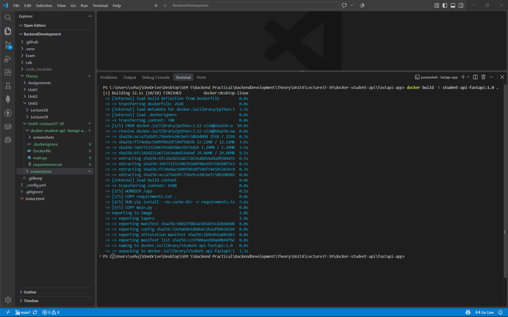

**FastAPI container running**

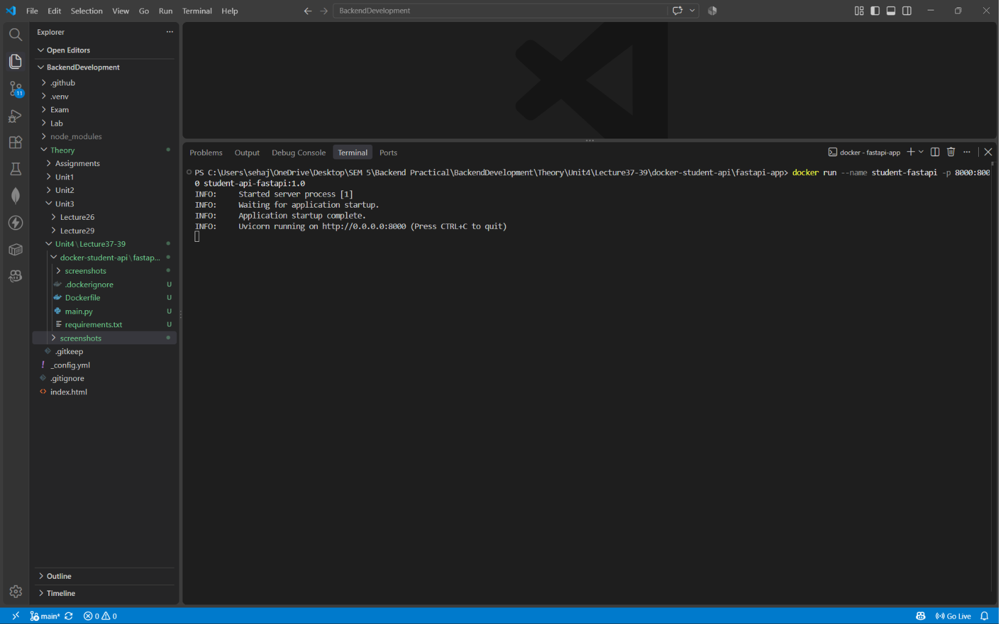

**FastAPI endpoint tests**

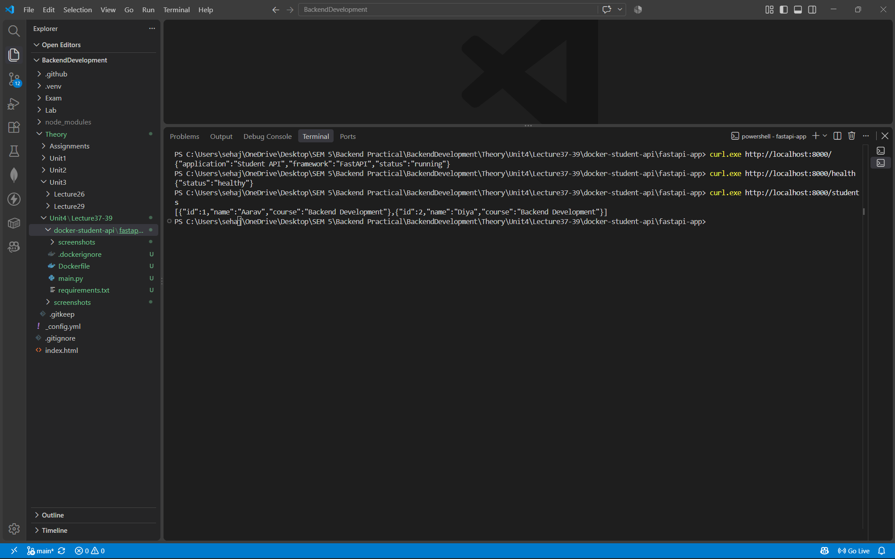

**FastAPI container status**

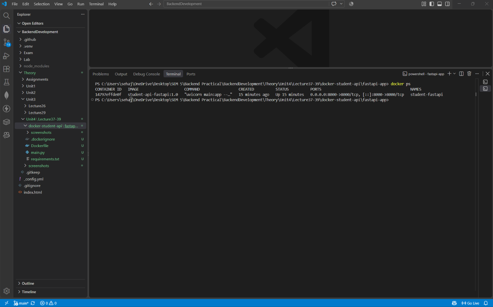

### Result

The `student-api-fastapi:1.0` image was built successfully. The FastAPI container ran with port mapping `8000:8000`. The root, health, and students endpoints returned the expected application information, healthy status, and student list.

---

## 7. Task 3: Create and Containerize the Express Student API

### Task Given

Create an equivalent Student API using Express. Configure the Node.js package, implement the required GET endpoints, create a Dockerfile and `.dockerignore`, build a separate Docker image, and run the application in a container.

### Implementation

The Express application was implemented in `server.js`. It uses the Express framework and defines the same two student records used by the FastAPI application.

| Endpoint | Implementation |
|---|---|
| `/` | Returns the application name, framework name, and running status. |
| `/health` | Returns `{"status": "healthy"}`. |
| `/students` | Returns the student records. |

The application reads its port from `process.env.PORT`, using port `3000` as the default, and listens on `0.0.0.0`.

The `package.json` file defines the application metadata, the `npm start` command, and the Express dependency. The project also contains `package-lock.json`, generated during dependency installation.

The Dockerfile uses `node:22-alpine` as its base image. It sets `/app` as the working directory, copies the package files, installs production dependencies using `npm install --omit=dev`, copies `server.js`, exposes port `3000`, and starts the application using `npm start`.

The `.dockerignore` file excludes `node_modules`, npm debug logs, the Git directory, and `.env` files from the Docker build context.

The image was built with the tag `student-api-express:1.0`. The container was run with host port `3000` mapped to container port `3000`.

### Code Location

| File | Purpose | GitHub Source |
|---|---|---|
| `server.js` | Express application and API routes | [View server.js](https://github.com/sehajvohra/BackendDevelopment/blob/main/Theory/Unit4/Lecture37-39/docker-student-api/express-app/server.js) |
| `package.json` | Node.js package configuration and start script | [View package.json](https://github.com/sehajvohra/BackendDevelopment/blob/main/Theory/Unit4/Lecture37-39/docker-student-api/express-app/package.json) |
| `package-lock.json` | Locked dependency tree | [View package-lock.json](https://github.com/sehajvohra/BackendDevelopment/blob/main/Theory/Unit4/Lecture37-39/docker-student-api/express-app/package-lock.json) |
| `Dockerfile` | Express image build instructions | [View Dockerfile](https://github.com/sehajvohra/BackendDevelopment/blob/main/Theory/Unit4/Lecture37-39/docker-student-api/express-app/Dockerfile) |
| `.dockerignore` | Files excluded from the build context | [View .dockerignore](https://github.com/sehajvohra/BackendDevelopment/blob/main/Theory/Unit4/Lecture37-39/docker-student-api/express-app/.dockerignore) |

[Open the Express application folder](https://github.com/sehajvohra/BackendDevelopment/tree/main/Theory/Unit4/Lecture37-39/docker-student-api/express-app)

### Screenshots

**Express Docker image build**

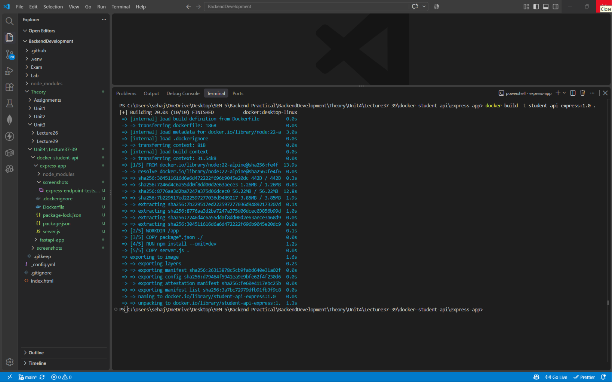

**Express container running**

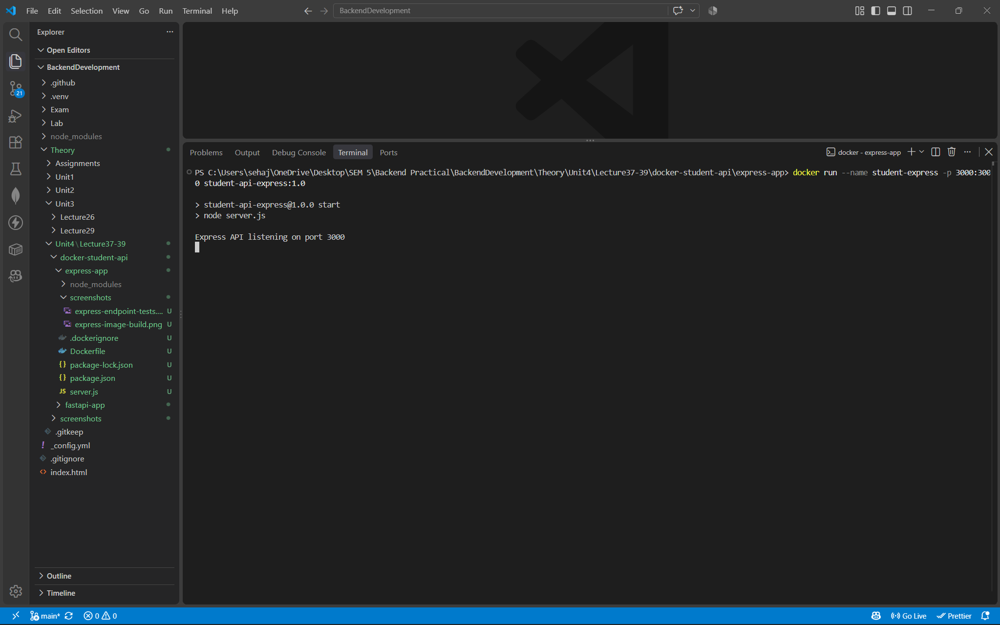

**Express endpoint tests**

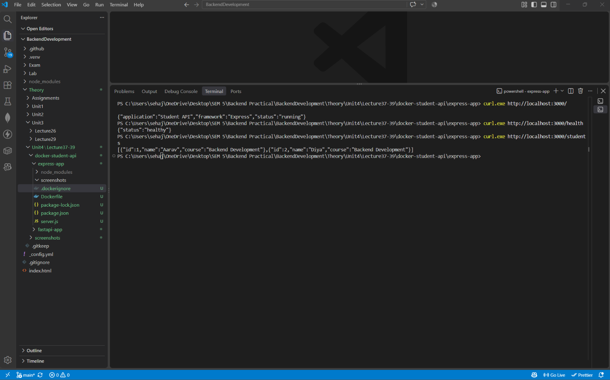

### Result

The `student-api-express:1.0` image was built successfully. The Express container ran with port mapping `3000:3000`. The root, health, and students endpoints returned the expected application information, healthy status, and student list.

---

## 8. Task 4: Run and Test Both Containers Together

### Task Given

Run the FastAPI and Express containers at the same time using separate host ports. Verify that both implementations expose the required API endpoints and return equivalent student data.

### Implementation

The FastAPI container was made available through host port `8000`, while the Express container was made available through host port `3000`.

| Application | Container Name | Image | Host Port | Container Port |
|---|---|---|---:|---:|
| FastAPI | `student-fastapi` | `student-api-fastapi:1.0` | 8000 | 8000 |
| Express | `student-express` | `student-api-express:1.0` | 3000 | 3000 |

Both containers were confirmed as running through Docker container inspection. Requests were sent to the health and students endpoints of both applications. The responses confirmed that both implementations returned a healthy status and the same two student records.

### Code Location

- [FastAPI application folder](https://github.com/sehajvohra/BackendDevelopment/tree/main/Theory/Unit4/Lecture37-39/docker-student-api/fastapi-app)
- [Express application folder](https://github.com/sehajvohra/BackendDevelopment/tree/main/Theory/Unit4/Lecture37-39/docker-student-api/express-app)
- [Complete Student API project folder](https://github.com/sehajvohra/BackendDevelopment/tree/main/Theory/Unit4/Lecture37-39/docker-student-api)

### Screenshots

**Both containers running**

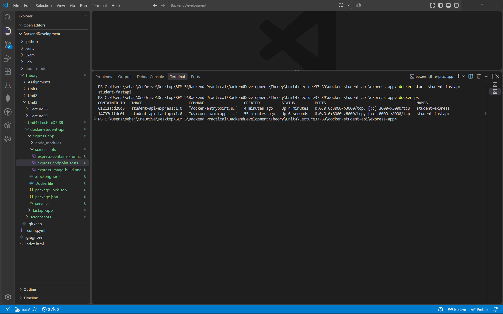

**FastAPI and Express API comparison**

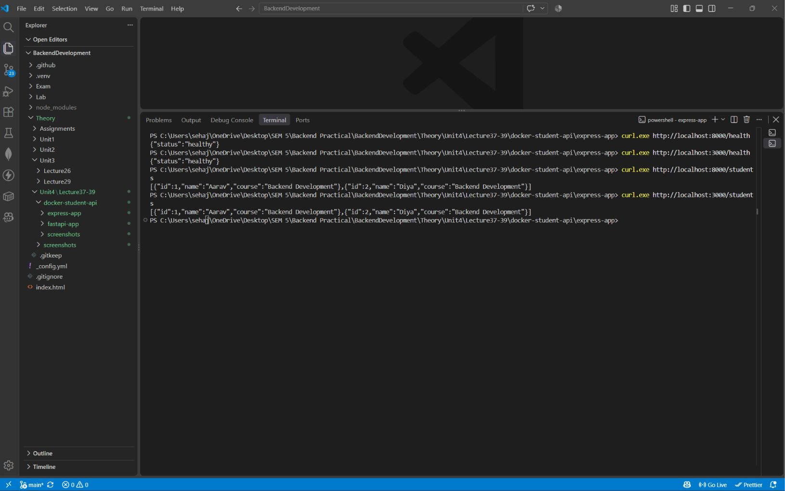

### Result

Both containers ran simultaneously on their separate ports. The tested endpoints returned successful responses, and both applications provided the same student data through the common API contract.

---

## 9. Task 5: Inspect Container Logs, Images, and Cleanup

### Task Given

Inspect the built Docker images, review the logs generated by both containers, and stop and remove the containers after testing.

### Implementation

Docker image inspection confirmed the presence of the FastAPI image tagged `student-api-fastapi:1.0` and the Express image tagged `student-api-express:1.0`.

The logs for both containers were inspected to review application startup and request activity. After testing, both containers were stopped and removed using Docker CLI commands. A final container listing was used to verify that the test containers had been removed. The Docker images were retained.

### Commands Used

```powershell
docker images
docker logs student-fastapi
docker logs student-express
docker stop student-fastapi student-express
docker rm student-fastapi student-express
docker ps -a
```

### Code Location

This task used Docker CLI commands and the Dockerfiles created in Tasks 2 and 3. It does not introduce an additional application source file.

- [FastAPI Dockerfile](https://github.com/sehajvohra/BackendDevelopment/blob/main/Theory/Unit4/Lecture37-39/docker-student-api/fastapi-app/Dockerfile)
- [Express Dockerfile](https://github.com/sehajvohra/BackendDevelopment/blob/main/Theory/Unit4/Lecture37-39/docker-student-api/express-app/Dockerfile)

### Screenshots

**Logs of both containers**

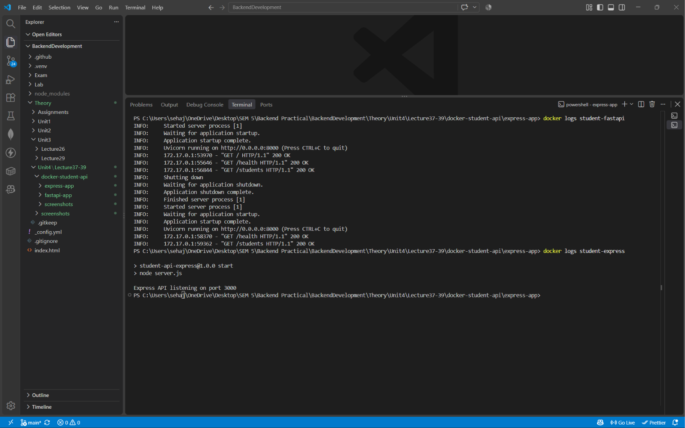

**Final Docker images**

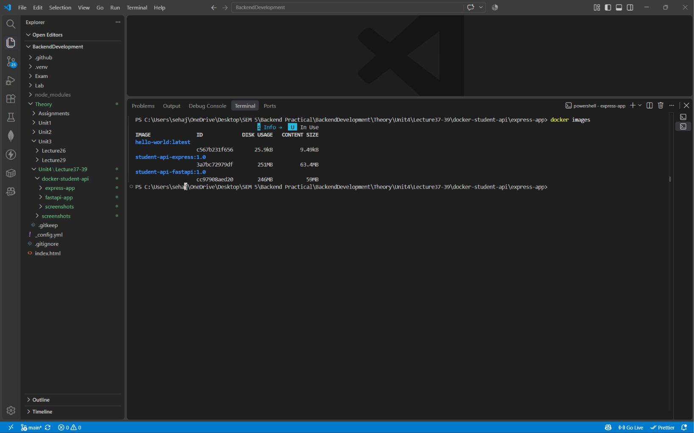

**Container cleanup**

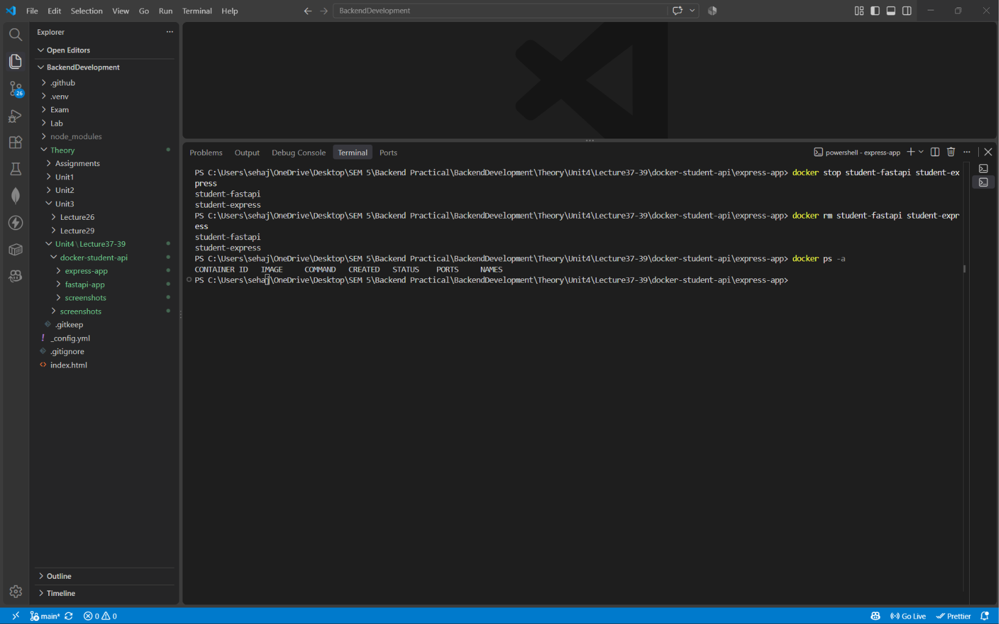

### Result

The logs showed the applications starting and processing the tested requests. Both test containers were stopped and removed successfully. The final container listing was empty, while the two built application images remained available locally.

---

## 10. Project Structure

The following structure is based on the supplied `Lecture37-39.zip` archive. The `node_modules` directory is present locally under `express-app`; its generated package contents are omitted from this source tree for readability. The FastAPI screenshot directory also contains a Windows `desktop.ini` metadata file, which is not part of the application implementation.

```text
Lecture37-39/
├── Report.md
├── screenshots/
│   ├── docker-container-cleanup.png
│   ├── docker-container-logs.png
│   ├── docker-containers.png.png
│   ├── docker-hello-world.png
│   ├── docker-images.png.png
│   └── docker-running-containers.png
└── docker-student-api/
    ├── express-app/
    │   ├── .dockerignore
    │   ├── Dockerfile
    │   ├── package-lock.json
    │   ├── package.json
    │   ├── server.js
    │   └── screenshots/
    │       ├── express-container-running.png
    │       ├── express-endpoint-tests.png
    │       └── express-image-build.png
    ├── fastapi-app/
    │   ├── .dockerignore
    │   ├── Dockerfile
    │   ├── main.py
    │   ├── requirements.txt
    │   └── screenshots/
    │       ├── fastapi-container-running.png
    │       ├── fastapi-container-status.png
    │       ├── fastapi-endpoint-tests.png
    │       └── fastapi-image-build.png
    └── screenshots/
        ├── both-apis-comparison.png
        ├── both-container-logs.png
        ├── both-containers-running.png
        ├── docker-container-cleanup.png
        └── docker-images-final.png
```

## 11. Concepts Used

1. Deployment environments and application configuration
2. Containerization and portable application execution
3. Docker Desktop, Docker Engine, and Docker CLI
4. Dockerfiles and base images
5. Docker image creation and tagging
6. Docker containers and container lifecycle
7. Port mapping between host and container
8. Docker build context and `.dockerignore`
9. Python dependencies and Uvicorn
10. Node.js package configuration and Express
11. HTTP GET routes and JSON responses
12. Binding application servers to `0.0.0.0`
13. Container inspection and log analysis
14. Testing equivalent API implementations
15. Stopping and removing containers

## 12. Overall Result

Two implementations of the Student API were created, one using FastAPI and the other using Express. Separate Docker images were built successfully for both applications. The containers were run on host ports `8000` and `3000`, and the required endpoints were tested. Both APIs returned healthy status responses and equivalent student records. Container logs were inspected, and the test containers were stopped and removed after verification.

## 13. Observations

1. Docker images package an application and its required runtime dependencies, while containers are runnable instances of those images.
2. The FastAPI and Express applications used different runtimes and frameworks but implemented the same three endpoint paths.
3. Mapping host port `8000` to container port `8000` and host port `3000` to container port `3000` allowed both APIs to run simultaneously.
4. Both applications listened on `0.0.0.0` inside their containers so that requests could reach them through Docker port mapping.
5. The `.dockerignore` files excluded development and unnecessary files from their respective Docker build contexts.
6. The health and students endpoint tests showed that both implementations returned equivalent API data.
7. Container logs provided information about application startup and incoming requests.
8. Removing a container did not require removing its Docker image. The application images remained available after container cleanup.

## 14. Conclusion

This practical demonstrated the use of Docker for packaging and running backend applications in containerized environments. The Student API was implemented independently with FastAPI and Express, and each implementation was built into its own Docker image. Both containers were run on separate ports and their endpoints were verified successfully. The practical also demonstrated image inspection, log analysis, and container cleanup.

## 15. Experiment Links

| Resource | Link |
|---|---|
| Backend Development GitHub Pages | [Open course website](https://sehajvohra.github.io/BackendDevelopment/) |
| Lecture 37–39 GitHub directory | [Open Lecture 37–39](https://github.com/sehajvohra/BackendDevelopment/tree/main/Theory/Unit4/Lecture37-39) |
| Complete Docker Student API source | [Open docker-student-api](https://github.com/sehajvohra/BackendDevelopment/tree/main/Theory/Unit4/Lecture37-39/docker-student-api) |
| FastAPI implementation | [Open fastapi-app](https://github.com/sehajvohra/BackendDevelopment/tree/main/Theory/Unit4/Lecture37-39/docker-student-api/fastapi-app) |
| Express implementation | [Open express-app](https://github.com/sehajvohra/BackendDevelopment/tree/main/Theory/Unit4/Lecture37-39/docker-student-api/express-app) |

---

**End of Report**
