# Unit 4 Practical

## Deploy a Student Management Express Application Using Docker Commit

### Student Information

| Field | Details |
|---|---|
| Name | Sehaj Vohra |
| SAP ID | 590011624 |
| Course | Backend Development |
| Program | B.Tech Computer Science and Engineering |
| Semester | 5 |

---

## 1. Objective

The objective of this practical is to develop a Student Management REST API using Node.js and Express, configure the application inside an Ubuntu 24.04 Docker container, and convert the configured container into a reusable Docker image using `docker commit`.

The practical also demonstrates exporting and reloading a Docker image using `docker save` and `docker load`, followed by deploying the application in a new container with Docker port mapping.

## 2. Software and Tools Used

| Software / Tool | Version or Configuration | Purpose |
|---|---|---|
| Docker Desktop | 29.9.2 | Container and image management |
| Ubuntu | 24.04 | Base container operating system |
| Node.js | 18.19.1 | JavaScript runtime |
| npm | 9.2.0 | Package management |
| Express.js | 5.3.0 | REST API development |
| Nodemon | 3.1.14 | Development server execution |
| Visual Studio Code | Used for project development | Source code editing |
| Windows PowerShell | Windows environment | Docker commands and API testing |
| Web Browser | Localhost testing | Testing API responses |

## 3. Problem Statement

Develop a Student Management application using Node.js and Express. The application must provide endpoints to display a welcome message, retrieve all student records, retrieve a particular student, add a student, and delete a student.

The application must be configured inside an Ubuntu 24.04 Docker container. After installing Node.js, npm, and the application dependencies, the configured container must be saved as a custom Docker image.

The image must then be exported to a TAR archive, removed from the local image repository, and restored using Docker. Finally, a new container must be created from the restored image, with host port 4000 mapped to container port 3000.

## 4. Task Summary

| Task | Task Name | Implementation | Outcome |
|---|---|---|---|
| 1 | Express Application | Developed a Student Management API using Express and an in-memory JavaScript array. | Application routes implemented and tested. |
| 2 | Ubuntu Container Configuration | Pulled Ubuntu 24.04, created `student-container`, installed Node.js and npm, copied application files into `/app`, and installed dependencies. | Configured Ubuntu container verified. |
| 3 | Custom Docker Image | Used `docker commit` to create `student-management:v1`. | Custom image created and verified. |
| 4 | Image Export and Reload | Exported the image as `student-management.tar`, removed the local image, and restored it using `docker load`. | Image restored and verified. |
| 5 | Deployment and Testing | Created `student-app` using the restored image and mapped host port 4000 to container port 3000. | Application started and API endpoints tested. |

## 5. Individual Task Details

## Task 1: Develop the Express Application

**Task Given**

Create a Student Management application using Node.js and Express. Implement the required HTTP endpoints and store student records in an in-memory JavaScript array.

**Implementation**

The application was developed using Express.js. The application listens on port `3000` and uses JSON middleware to process JSON request bodies.

The following API endpoints were implemented:

| HTTP Method | Endpoint | Functionality |
|---|---|---|
| GET | `/` | Displays the application welcome message. |
| GET | `/students` | Retrieves all student records. |
| GET | `/students/:id` | Retrieves a particular student using the student ID. |
| POST | `/students` | Adds a new student record. |
| DELETE | `/students/:id` | Deletes a student using the student ID. |

Student records are maintained in an in-memory JavaScript array. Consequently, the records are temporary and are not stored in a persistent database.

**Dependencies**

| Package | Version | Purpose |
|---|---:|---|
| Express | 5.3.0 | Handles HTTP requests and API routes. |
| Nodemon | 3.1.14 | Runs the application in development mode and restarts it when files change. |

The project uses the following npm scripts:

| Script | Command |
|---|---|
| Start | `node app.js` |
| Development | `nodemon app.js` |

**Code Location**

- [Application source: app.js](https://github.com/sehajvohra/BackendDevelopment/blob/main/Theory/Unit4/docker-commit-student-management/Task1_Express_Application/app.js)
- [Package configuration: package.json](https://github.com/sehajvohra/BackendDevelopment/blob/main/Theory/Unit4/docker-commit-student-management/Task1_Express_Application/package.json)
- [Package lock file](https://github.com/sehajvohra/BackendDevelopment/blob/main/Theory/Unit4/docker-commit-student-management/Task1_Express_Application/package-lock.json)
- [Task 1 directory](https://github.com/sehajvohra/BackendDevelopment/tree/main/Theory/Unit4/docker-commit-student-management/Task1_Express_Application)

**Screenshots**

**Express server running**

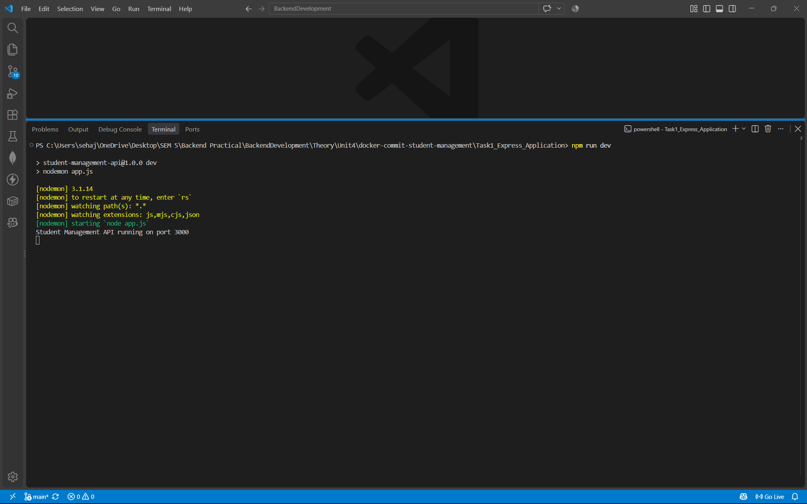

**Application welcome endpoint**

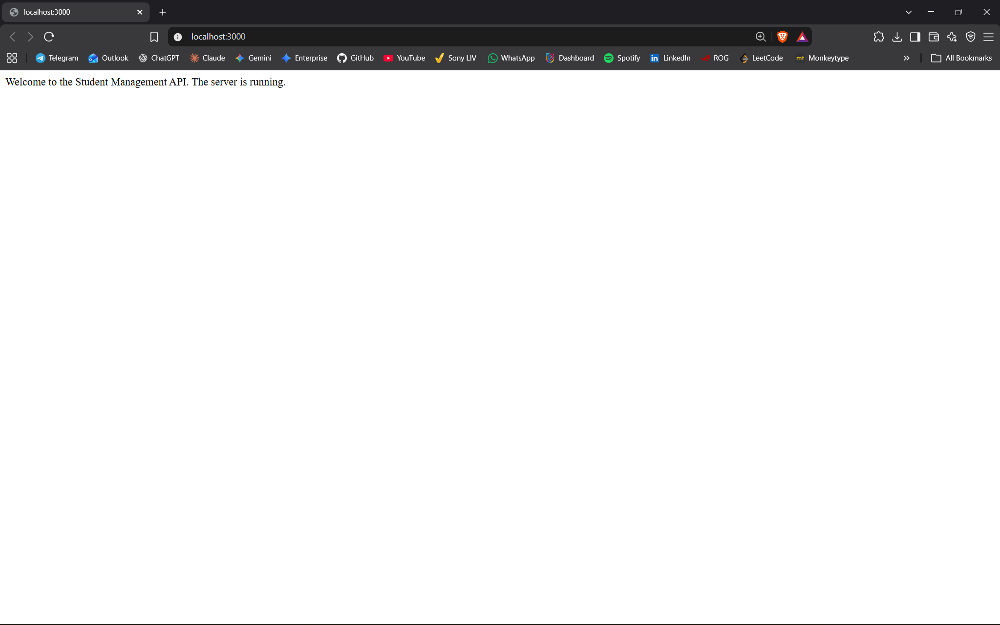

**Retrieve all students**

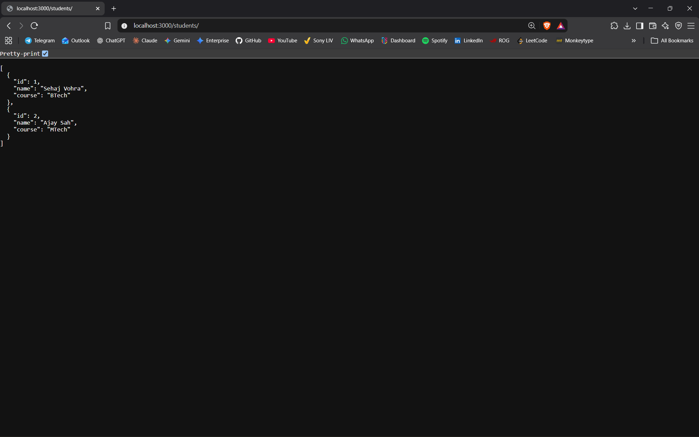

**Retrieve student by ID**

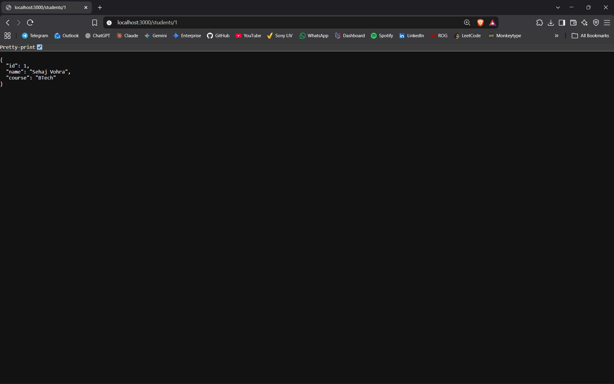

**Add a student**

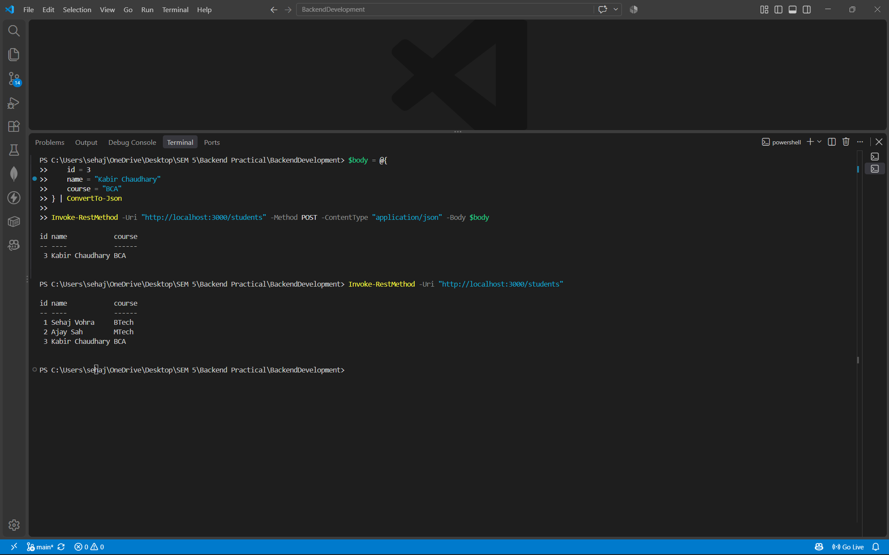

**Delete a student**

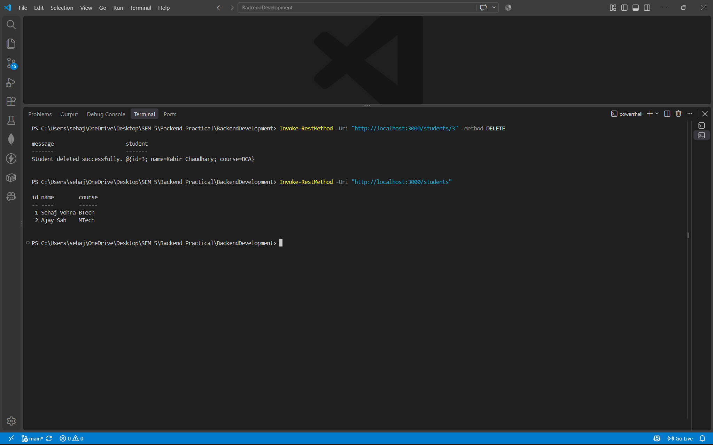

**Result**

The Express application was created with the five required API endpoints. The screenshots document server execution and the individual API operations.

## Task 2: Configure the Ubuntu Container

**Task Given**

Pull Ubuntu 24.04, create a container named `student-container`, install Node.js and npm, create the `/app` directory, copy the Express application files into the container, and install the required dependencies.

**Implementation**

The Ubuntu 24.04 image was pulled from Docker Hub. A container named `student-container` was created and started.

Node.js and npm were installed inside the Ubuntu container using the Ubuntu package manager.

| Component | Installed Version |
|---|---|
| Ubuntu | 24.04 |
| Node.js | 18.19.1 |
| npm | 9.2.0 |

The application directory `/app` was created inside the container. The following application files were copied from the host machine:

| File | Purpose |
|---|---|
| `app.js` | Express application source code |
| `package.json` | Project metadata, dependencies, and npm scripts |
| `package-lock.json` | Dependency version lock information |

The dependencies were installed from inside `/app` using `npm install`. The installed top level packages were verified using `npm list --depth=0`.

**Important Commands**

| Command | Purpose |
|---|---|
| `docker pull ubuntu:24.04` | Downloads the Ubuntu image. |
| `docker run -dit --name student-container ubuntu:24.04 bash` | Creates and starts the Ubuntu container. |
| `apt update` | Updates the package information. |
| `apt install -y nodejs npm` | Installs Node.js and npm. |
| `mkdir -p /app` | Creates the application directory. |
| `docker cp` | Copies application files into the container. |
| `npm install` | Installs application dependencies. |
| `npm list --depth=0` | Displays installed top level packages. |

**Code Location**

The application files used to configure the container are maintained in:

- [Task 1 application directory](https://github.com/sehajvohra/BackendDevelopment/tree/main/Theory/Unit4/docker-commit-student-management/Task1_Express_Application)

**Screenshots**

**Ubuntu image pulled**

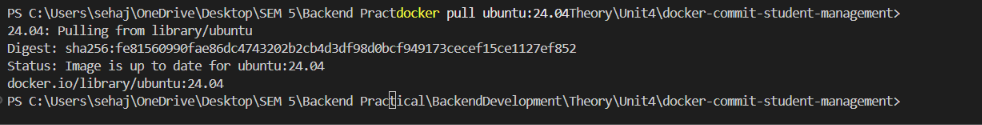

**Ubuntu container running**

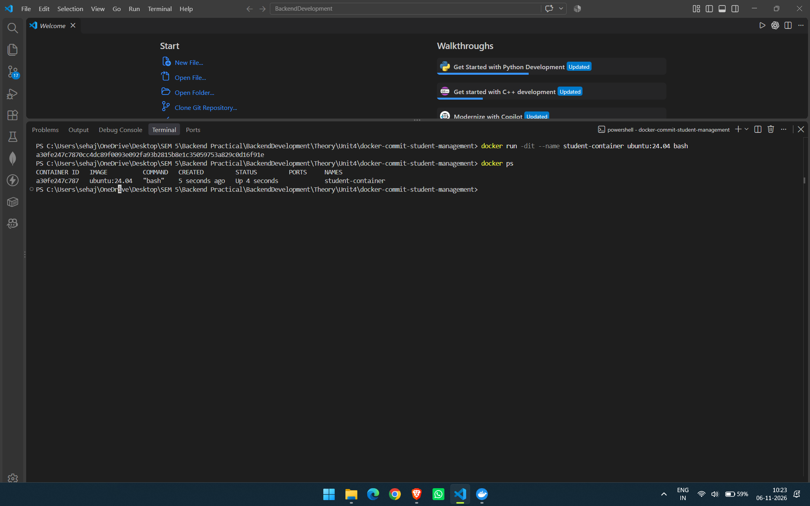

**Node.js and npm installed**

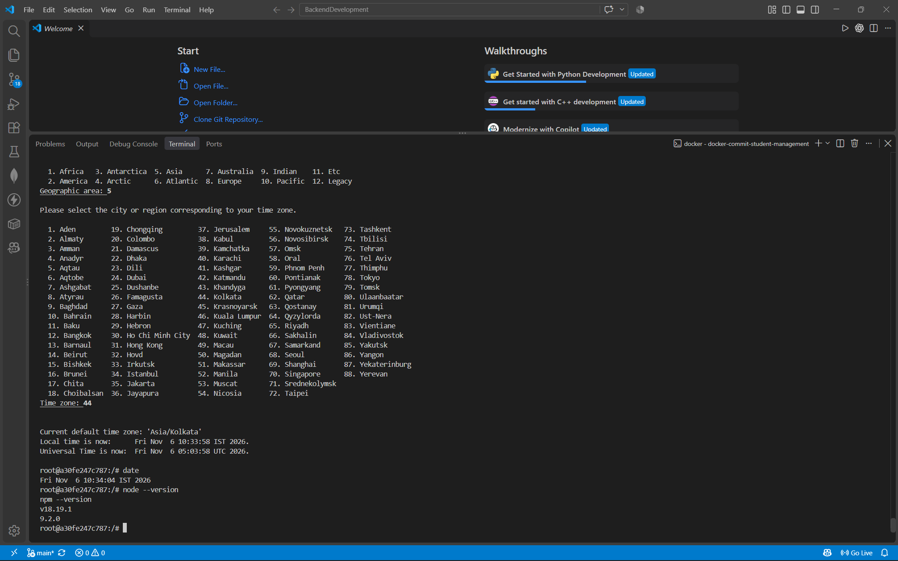

**Application files copied into the container**

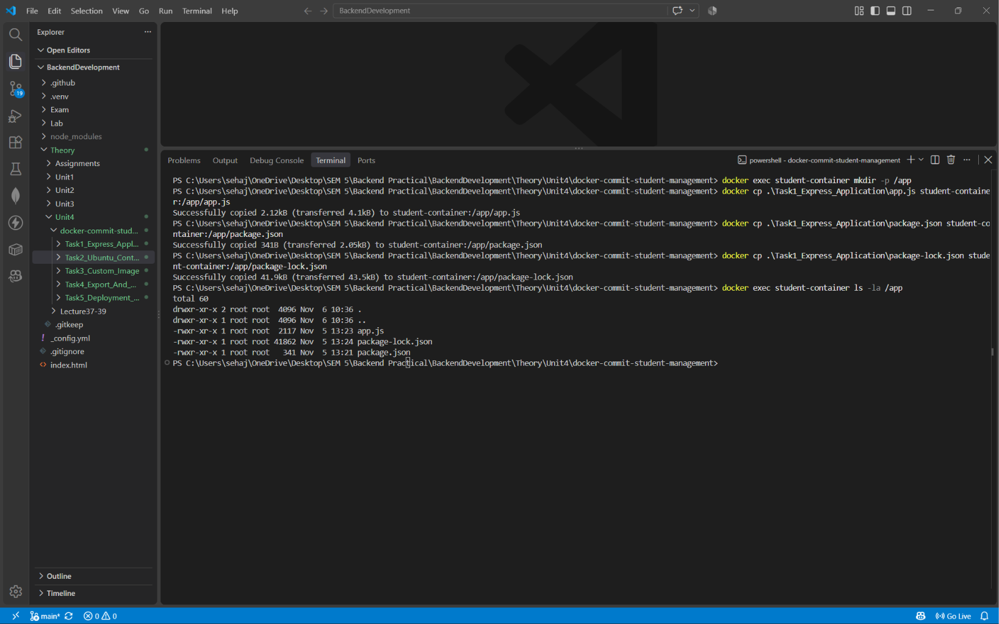

**Dependencies installed**

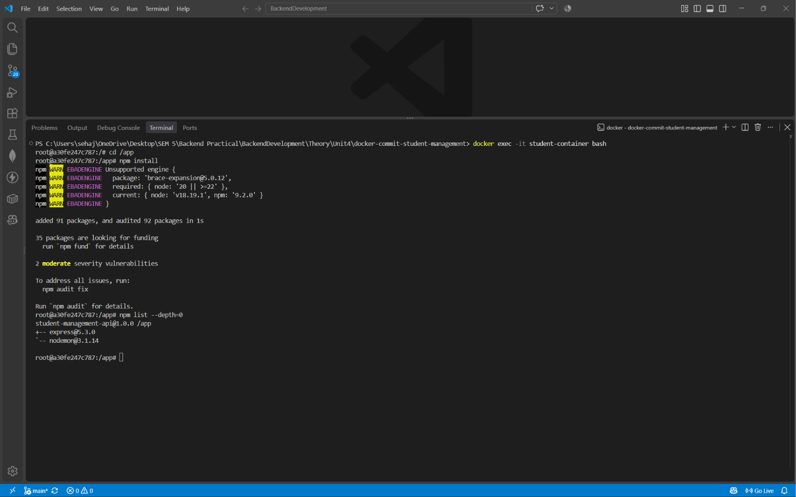

**Application tested inside the container**

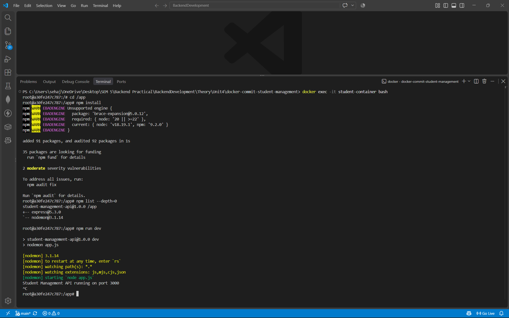

**Result**

The Ubuntu container was configured with Node.js, npm, the application files, and the required npm dependencies. The application was also started inside the container to verify its execution.

## Task 3: Create a Custom Docker Image

**Task Given**

Save the configured Ubuntu container as a reusable Docker image named `student-management:v1` using the `docker commit` command.

**Implementation**

After configuring `student-container`, the container's filesystem changes were committed to a new Docker image.

The command used was:

```bash
docker commit student-container student-management:v1
```

The image was checked using:

```bash
docker images
```

| Parameter | Value |
|---|---|
| Source container | `student-container` |
| Image repository | `student-management` |
| Image tag | `v1` |
| Complete image name | `student-management:v1` |

The resulting image contains the configured Ubuntu environment, installed Node.js and npm packages, application files, and installed project dependencies.

**Code Location**

- [Task 3 directory and evidence](https://github.com/sehajvohra/BackendDevelopment/tree/main/Theory/Unit4/docker-commit-student-management/Task3_Custom_Image)

**Screenshot**

**Custom Docker image created**

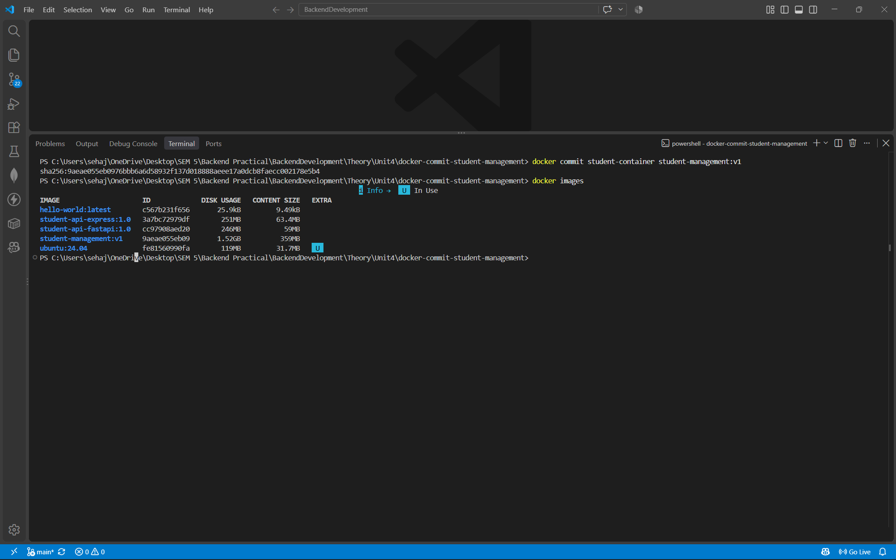

**Result**

The configured container was successfully committed as the custom Docker image `student-management:v1`. The image was verified in the local Docker image list.

## Task 4: Export and Reload the Docker Image

**Task Given**

Export the custom Docker image as `student-management.tar`, remove the local image, and restore it using `docker load`.

**Implementation**

The custom image was exported to a TAR archive using `docker save`.

```bash
docker save -o student-management.tar student-management:v1
```

After verifying the archive, the local image was removed:

```bash
docker image rm student-management:v1
```

The image was then restored from the TAR archive:

```bash
docker load -i student-management.tar
```

The restored image was checked using:

```bash
docker images
```

| Operation | Command | Purpose |
|---|---|---|
| Export image | `docker save -o student-management.tar student-management:v1` | Saves the image to a TAR archive. |
| Remove image | `docker image rm student-management:v1` | Removes the local image. |
| Reload image | `docker load -i student-management.tar` | Restores the image from the archive. |
| Verify image | `docker images` | Checks that the image is available. |

**Code Location**

- [Task 4 directory and evidence](https://github.com/sehajvohra/BackendDevelopment/tree/main/Theory/Unit4/docker-commit-student-management/Task4_Export_And_Reload)

**Screenshots**

**Docker image exported**

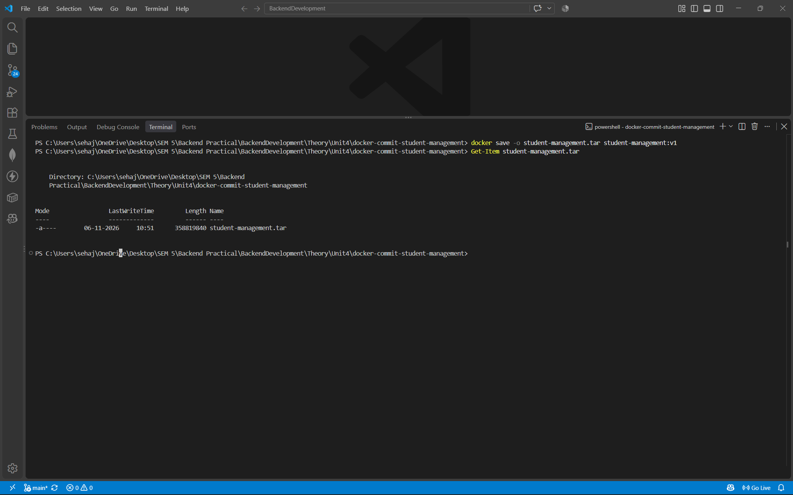

**Docker image reloaded**

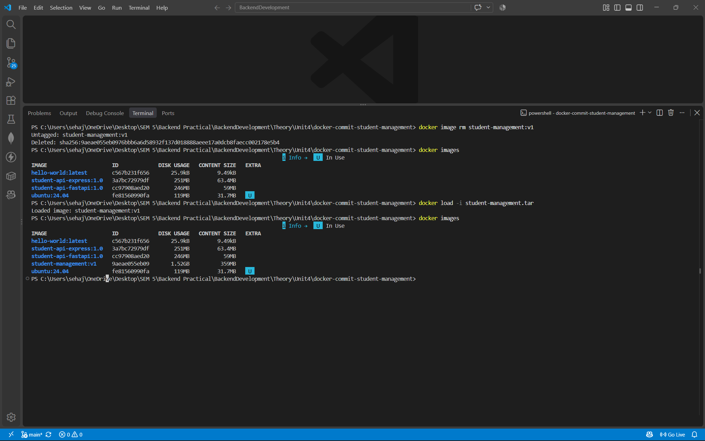

**Result**

The custom image was exported, removed from the local image repository, and restored from the TAR archive using `docker load`. The restored image was verified.

## Task 5: Deploy and Test the Application

**Task Given**

Create a new container named `student-app` using `student-management:v1`. Map host port `4000` to container port `3000` and start the application using `npm run dev`.

**Implementation**

A new container was created from the restored custom image. The application was started from the `/app` directory using the npm development script.

The deployment command was:

```bash
docker run -d --name student-app -p 4000:3000 student-management:v1 sh -c "cd /app && npm run dev"
```

The container status was checked using:

```bash
docker ps
```

Application logs were checked using:

```bash
docker logs student-app
```

The application log displayed:

```text
Student Management API running on port 3000
```

**Deployment Configuration**

| Parameter | Value |
|---|---|
| Container name | `student-app` |
| Docker image | `student-management:v1` |
| Host port | `4000` |
| Container port | `3000` |
| Port mapping | `4000:3000` |
| Startup command | `npm run dev` |
| Application URL | `http://localhost:4000` |

**API Testing**

The application was accessed through the host port using the following endpoints:

| HTTP Method | URL | Operation |
|---|---|---|
| GET | `http://localhost:4000/` | Welcome endpoint |
| GET | `http://localhost:4000/students` | Retrieve all students |
| GET | `http://localhost:4000/students/1` | Retrieve a student by ID |
| POST | `http://localhost:4000/students` | Add a student |
| DELETE | `http://localhost:4000/students/3` | Delete a student |

The GET, POST, and DELETE operations were tested by accessing the deployed application. The endpoint testing screenshots are included below.

**Code Location**

- [Task 5 directory and evidence](https://github.com/sehajvohra/BackendDevelopment/tree/main/Theory/Unit4/docker-commit-student-management/Task5_Deployment_And_Testing)
- [Express application source](https://github.com/sehajvohra/BackendDevelopment/blob/main/Theory/Unit4/docker-commit-student-management/Task1_Express_Application/app.js)

**Screenshots**

**Student application running**

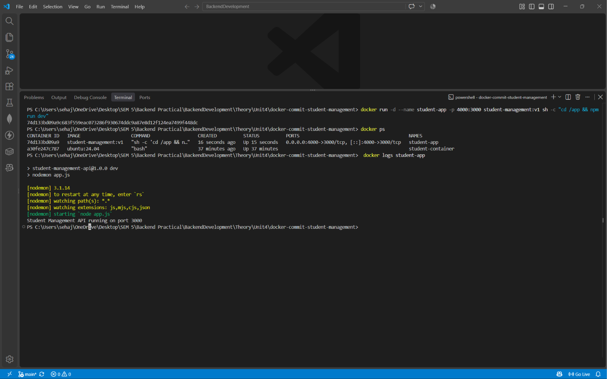

**Welcome endpoint**

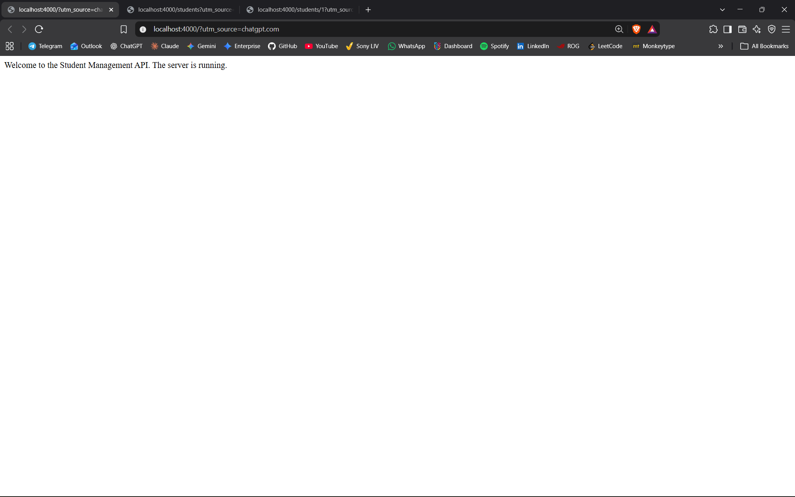

**Retrieve all students**

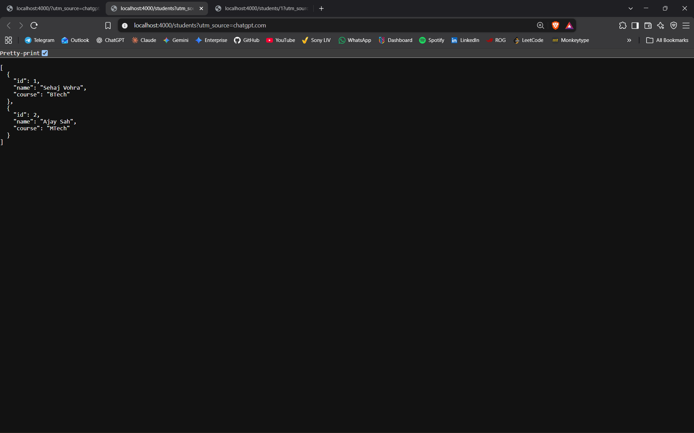

**Retrieve a student by ID**

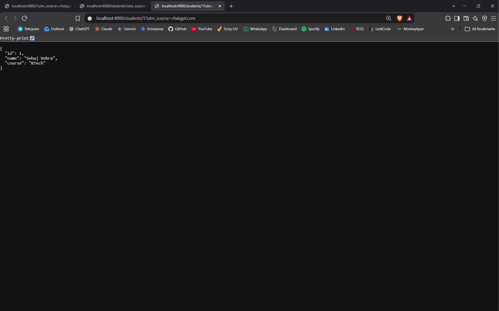

**Add a student**

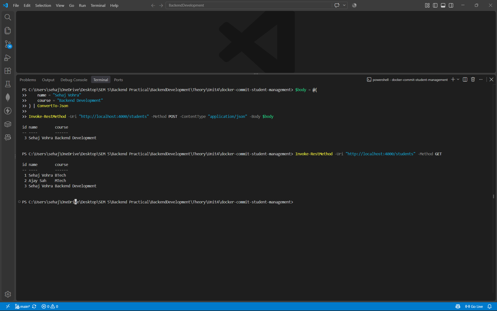

**Delete a student**

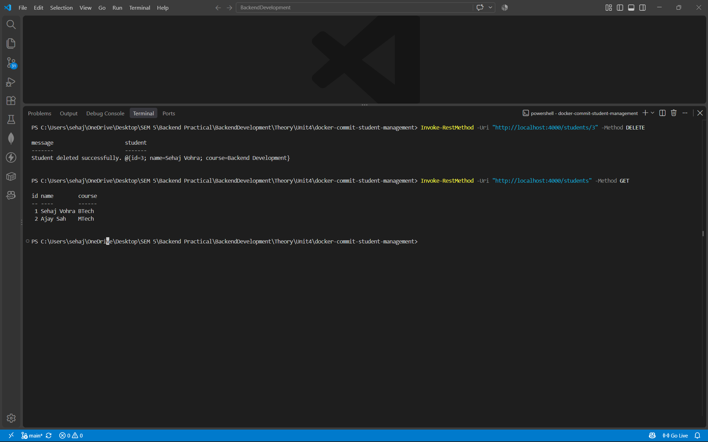

**Final Docker verification**

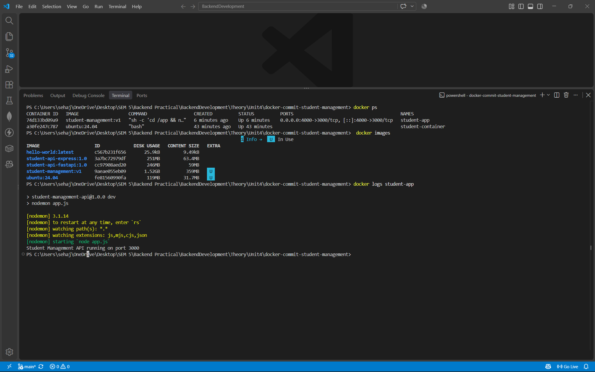

**Result**

The `student-app` container was created using the restored `student-management:v1` image. Docker port mapping exposed the application through host port `4000`. The container status and application logs were checked, and the API endpoints were tested through the browser and PowerShell.

## 6. Project Structure

The practical is organized into five task directories. Each task has its own `screenshots` directory.

```text
docker-commit-student-management/
│
├── .gitignore
│
├── Task1_Express_Application/
│   ├── app.js
│   ├── package.json
│   ├── package-lock.json
│   ├── .gitignore
│   └── screenshots/
│       ├── express-server-running.png
│       ├── student-api-home.png
│       ├── student-by-id.png
│       ├── student-create.png
│       ├── student-delete.png
│       └── student-list.png
│
├── Task2_Ubuntu_Container/
│   └── screenshots/
│       ├── application-files-copied.png
│       ├── express-app-container-test.png
│       ├── nodejs-npm-installed.png
│       ├── ubuntu-container-running.png
│       ├── ubuntu-dependencies-installed.png
│       └── ubuntu-image-pulled.png
│
├── Task3_Custom_Image/
│   └── screenshots/
│       └── custom-image-created.png
│
├── Task4_Export_And_Reload/
│   └── screenshots/
│       ├── image-exported.png
│       └── image-reloaded.png
│
└── Task5_Deployment_And_Testing/
    └── screenshots/
        ├── delete-student.png
        ├── final-docker-verification.png
        ├── get-all-students.png
        ├── get-single-student.png
        ├── post-add-student.png
        ├── student-app-running.png
        └── welcome-endpoint.png
```

The `node_modules` directory is generated when npm dependencies are installed and is excluded from Git tracking through `.gitignore`. The exported `student-management.tar` archive is also excluded from Git tracking.

## 7. Concepts Used

| Concept | Application in the Practical |
|---|---|
| Node.js | Runtime environment for the Express application. |
| Express.js | Framework used to implement HTTP routes and API endpoints. |
| REST API | Communication through HTTP methods and resource endpoints. |
| JSON Middleware | Processes JSON request bodies. |
| In-memory Storage | Stores student records in a JavaScript array. |
| Docker Image | Reusable template containing the configured application environment. |
| Docker Container | Isolated environment used to run the application. |
| `docker pull` | Downloads the Ubuntu base image. |
| `docker run` | Creates and starts containers. |
| `docker exec` | Executes commands inside a running container. |
| `docker cp` | Copies application files between the host and container. |
| `docker commit` | Creates a new image from a container's filesystem changes. |
| `docker save` | Exports a Docker image into a TAR archive. |
| `docker load` | Restores an image from a TAR archive. |
| Port Mapping | Exposes the container application through a host port. |
| Nodemon | Runs the application in development mode. |

## 8. Overall Result

The Student Management Express application was developed with five API endpoints and configured inside an Ubuntu 24.04 Docker container.

Node.js, npm, Express.js, Nodemon, and the application dependencies were installed in the container. The configured container was committed as `student-management:v1`.

The image was exported to `student-management.tar`, removed from the local image repository, and successfully restored using `docker load`.

A new container named `student-app` was created from the restored image. The application was started using `npm run dev` and exposed through host port `4000`, mapped to container port `3000`.

The Docker container status, application logs, and API operations were checked as part of the practical.

## 9. Observations

1. Docker containers provide an isolated environment in which an application and its dependencies can run.
2. The `docker cp` command makes it possible to transfer application files from the host machine into a running container.
3. Installing Node.js, npm, and application dependencies inside the Ubuntu container prepares the environment required to execute the Express application.
4. The `docker commit` command captures filesystem changes made to a container and saves them as a reusable image. It does not preserve the running application process.
5. The `docker save` and `docker load` commands allow Docker images to be exported and restored through an archive.
6. The `4000:3000` port mapping forwards requests received on host port `4000` to container port `3000`.
7. The application uses an in-memory JavaScript array, so student records are not persistent across application restarts.

During dependency installation, npm displayed a compatibility warning for a dependency requiring a newer Node.js version. The application nevertheless started successfully in the configured container and its server startup message was observed.

## 10. Conclusion

This practical demonstrated the development and containerization of a Student Management REST API using Node.js, Express.js, and Docker.

The application was configured inside an Ubuntu 24.04 container, and the configured container was converted into a reusable Docker image using `docker commit`. The image was exported and restored using `docker save` and `docker load`.

Finally, the restored image was used to create a new application container with port mapping. The practical provided hands-on experience with Docker image management, container configuration, file transfer, application deployment, and API testing.

## 11. Experiment Links

| Resource | Link |
|---|---|
| Backend Development GitHub Pages | [Open Backend Development](https://sehajvohra.github.io/BackendDevelopment/) |
| GitHub Repository | [BackendDevelopment](https://github.com/sehajvohra/BackendDevelopment) |
| Unit 4 Directory | [Open Unit 4](https://github.com/sehajvohra/BackendDevelopment/tree/main/Theory/Unit4) |
| Complete Practical Directory | [Docker Commit Student Management](https://github.com/sehajvohra/BackendDevelopment/tree/main/Theory/Unit4/docker-commit-student-management) |
| Task 1: Express Application | [Open Task 1](https://github.com/sehajvohra/BackendDevelopment/tree/main/Theory/Unit4/docker-commit-student-management/Task1_Express_Application) |
| Task 2: Ubuntu Container | [Open Task 2](https://github.com/sehajvohra/BackendDevelopment/tree/main/Theory/Unit4/docker-commit-student-management/Task2_Ubuntu_Container) |
| Task 3: Custom Image | [Open Task 3](https://github.com/sehajvohra/BackendDevelopment/tree/main/Theory/Unit4/docker-commit-student-management/Task3_Custom_Image) |
| Task 4: Export and Reload | [Open Task 4](https://github.com/sehajvohra/BackendDevelopment/tree/main/Theory/Unit4/docker-commit-student-management/Task4_Export_And_Reload) |
| Task 5: Deployment and Testing | [Open Task 5](https://github.com/sehajvohra/BackendDevelopment/tree/main/Theory/Unit4/docker-commit-student-management/Task5_Deployment_And_Testing) |

---

**End of Report**

